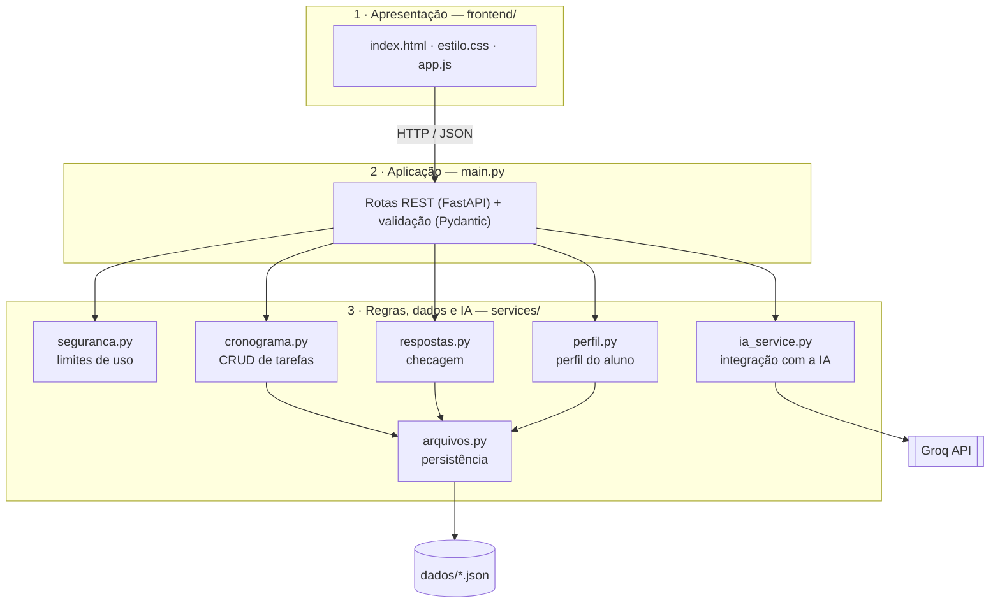
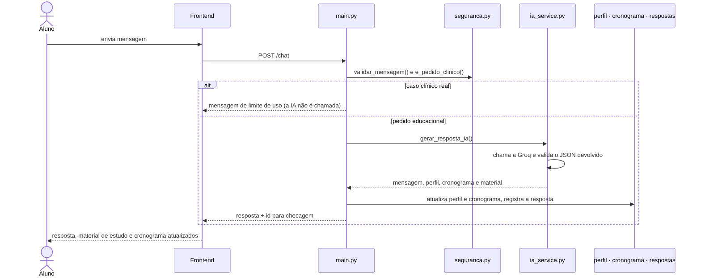
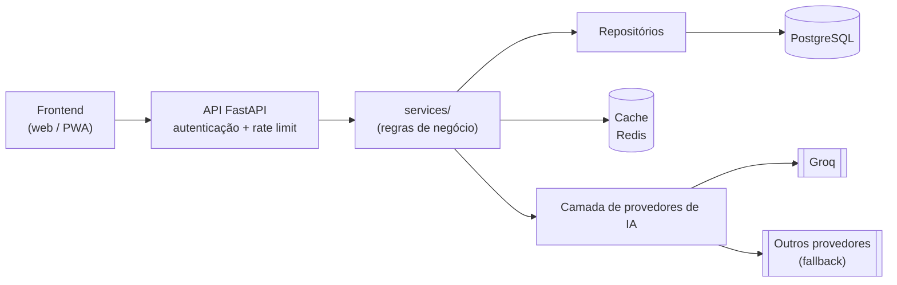

<div align="center">

# Educa-Med

**Assistente de estudos com IA para estudantes de Medicina: organiza a rotina, ensina e treina o senso crítico no uso de IA.**

[](https://educa-med.vercel.app)


[**Abrir a demo**](https://educa-med.vercel.app) · [Mapa do código](docs/MAPA_DO_CODIGO.md) · [IA e dependências](docs/DEPENDENCIAS.md)

</div>

---

## Sumário

- [Sobre o projeto](#sobre-o-projeto)
- [Funcionalidades](#funcionalidades)
- [Letramento em IA na prática](#letramento-em-ia-na-prática)
- [Arquitetura](#arquitetura)
- [Tecnologias](#tecnologias)
- [Como rodar localmente](#como-rodar-localmente)
- [API](#api)
- [Modelo de dados](#modelo-de-dados)
- [Deploy na Vercel](#deploy-na-vercel)
- [Segurança e limites de uso](#segurança-e-limites-de-uso)
- [Limitações conhecidas](#limitações-conhecidas)
- [Roadmap de escalabilidade](#roadmap-de-escalabilidade)
- [Contribuindo](#contribuindo)
- [Licença](#licença)

---

## Sobre o projeto

Estudantes de Medicina lidam com uma rotina intensa, muito conteúdo e um uso cada vez maior de IA nos estudos. A facilidade de obter respostas rápidas faz muitos aceitarem o que a IA diz sem verificar fontes ou entender suas limitações, o que na Medicina é especialmente arriscado.

O **Educa-Med** usa a IA como **apoio** ao aprendizado, nunca como substituta do conhecimento:

- **organiza** a rotina com cronogramas personalizados por área, tempo disponível e método de estudo;
- **ensina** com resumos, pontos-chave e questões de múltipla escolha corrigidas na hora;
- **forma senso crítico**: cada resposta indica onde conferir, e o próprio aluno registra se checou ou se encontrou um erro.

O uso é **exclusivamente educacional**: casos clínicos reais, diagnósticos e pedidos de medicação são bloqueados antes de chegar à IA.

> Evolução do *Humanizy Med*, que originalmente era um chatbot de orientação inicial em saúde.

---

## Funcionalidades

| | Funcionalidade | Como funciona |
|---|---|---|
| 🗓️ | **Cronograma personalizado** | A IA descobre a área, a rotina e o método de estudo e monta um plano por dia. O aluno pode criar, editar, concluir e remover tarefas (CRUD completo). |
| 📚 | **Estudar com IA** | Em cada tarefa, gera um resumo em tópicos, pontos-chave e questões com correção e explicação. |
| 💬 | **Chat que ensina** | Pedidos como *"me explica farmacocinética e faz questões"* geram o mesmo material direto no chat. |
| 🛡️ | **Limites de uso** | Pedidos de caso clínico real, diagnóstico ou medicação são barrados antes da chamada à IA. |
| 🔍 | **Checagem das respostas** | Toda resposta mostra *onde conferir* e os botões **Conferi na fonte** / **Achei um erro**. |
| 📊 | **Painel de senso crítico** | Mostra a porcentagem de respostas da IA que o aluno checou. |
| 🏷️ | **Transparência** | Tarefas sugeridas pela IA recebem o selo **IA**, diferenciando-as das criadas pelo aluno. |
| 💾 | **Persistência** | Cronograma, perfil e histórico ficam salvos e são restaurados ao recarregar a página. |
| 🧪 | **Modo demonstração** | Sem chave de IA configurada, o sistema responde com dados de exemplo e funciona até sem internet. |

---

## Letramento em IA na prática

| Princípio | Como o sistema aplica |
|---|---|
| **Compreender** — saber que é uma IA e conhecer seus limites | Aviso fixo de uso educacional, selo **IA** nas tarefas geradas e rótulo *"gerado por IA"* em todo material de estudo. |
| **Criticar** — conferir antes de confiar | *Onde conferir* em cada resposta, botões de checagem e taxa de verificação visível. Questões geradas por IA também podem errar, e o botão **Achei um erro** existe para isso. |
| **Usar com apoio** — a IA não substitui professores e livros | Filtro de segurança antes da IA, instruções de limite no prompt e orientação para procurar professor ou serviço de saúde em situações reais. |

---

## Arquitetura 

Aplicação em **3 camadas**: o frontend fala com a API por HTTP/JSON, e a API delega as regras para módulos com uma responsabilidade cada.



### Fluxo de uma mensagem



### Decisões de projeto

- **Uma responsabilidade por módulo.** Cada arquivo de `services/` resolve um problema e é testável isoladamente.
- **Pontos únicos de troca.** Toda leitura e gravação passa por `arquivos.py`, e toda chamada de IA passa por `ia_service.py`. Trocar JSON por banco de dados, ou Groq por outro provedor, não exige mexer nas rotas nem no frontend.
- **Defesa em camadas.** Há um filtro antes da IA, limites no prompt e validação da resposta: `padronizar_resposta()` e `padronizar_material()` descartam campos e questões mal formatados.
- **Frontend sem build.** HTML, CSS e JavaScript puros, servidos pelo próprio FastAPI. É um único deploy, sem Node em produção.

### Estrutura de pastas

```
educa-med/
├── main.py                 # Rotas da API (chat, CRUD, estudo, checagem)
├── index.py                # Ponto de entrada para a Vercel
├── services/
│   ├── arquivos.py         # Leitura e gravação de JSON
│   ├── texto.py            # Normalização de texto e conversão de durações
│   ├── seguranca.py        # Validação e bloqueio de pedidos clínicos
│   ├── cronograma.py       # CRUD de tarefas + resumo semanal (matriz)
│   ├── respostas.py        # Registro e checagem das respostas da IA
│   ├── perfil.py           # Perfil do aluno (área, rotina, método)
│   └── ia_service.py       # Prompts, chamada à Groq e validação da resposta
├── frontend/
│   ├── index.html
│   ├── estilo.css
│   └── app.js
├── docs/
│   ├── MAPA_DO_CODIGO.md   # Conteúdo de Python → arquivo → função
│   └── DEPENDENCIAS.md     # Detalhes da IA e erros comuns
├── dados/                  # Criada automaticamente (fora do Git)
├── requirements.txt
├── .env.example
└── .vercelignore
```

### Conteúdos de Python aplicados

Projeto acadêmico: cada conteúdo da disciplina aparece em uma parte real do sistema. O roteiro completo, com funções e falas para a apresentação, está em [`docs/MAPA_DO_CODIGO.md`](docs/MAPA_DO_CODIGO.md).

| Conteúdo | Onde aparece |
|---|---|
| Variáveis e operadores | `texto.formatar_minutos()` (`//` e `%`) e taxa de verificação em `respostas.py` |
| Estruturas condicionais | `seguranca.validar_mensagem()` e o bloqueio de pedidos clínicos em `main.chat()` |
| Estruturas de repetição | `seguranca.e_pedido_clinico()` e `cronograma.gerar_novo_id()` |
| Listas e matrizes | `cronograma.montar_resumo()`: matriz `[dia, tarefas, concluídas, minutos]` |
| Strings | `texto.normalizar_texto()` e `texto.converter_duracao_para_minutos()` |
| Funções | Todos os módulos de `services/` |
| Mapeamento de arquivos | `arquivos.ler_json()` e `arquivos.salvar_json()` |
| Tratamento de erros | Arquivo ausente ou corrompido, falha da IA (HTTP 503) e duração inválida |

---

## Tecnologias

| Camada | Tecnologia |
|---|---|
| Backend | Python 3.10+, FastAPI, Pydantic, Uvicorn |
| IA | [Groq API](https://console.groq.com), modelo `openai/gpt-oss-120b` em modo JSON |
| Frontend | HTML, CSS e JavaScript puros |
| Persistência | Arquivos JSON |
| Deploy | Vercel (funções Python) |

---

## Como rodar localmente

**Pré-requisitos:** Python 3.10+ e uma chave gratuita da [Groq](https://console.groq.com). A chave é opcional: sem ela, o sistema roda em modo demonstração.

```bash
git clone https://github.com/MDN-Solutions/educa-med.git
cd educa-med

python -m venv venv
source venv/bin/activate          # Windows: venv\Scripts\activate
pip install -r requirements.txt

cp .env.example .env              # depois, cole sua chave no .env
uvicorn main:app --reload
```

- Aplicação: **http://localhost:8000**
- Documentação interativa da API (Swagger): **http://localhost:8000/docs**

### Variáveis de ambiente

| Variável | Obrigatória | Descrição |
|---|---|---|
| `GROQ_API_KEY` | Não | Chave da Groq. Sem ela, ativa o modo demonstração. |
| `VERCEL` | Automática | Definida pela própria Vercel. Faz os dados serem gravados em `/tmp`. |

### Trocando o modelo de IA

O modelo fica na constante `MODELO_IA`, em `services/ia_service.py`. Para ver os modelos disponíveis na sua conta:

```bash
python -c "
from dotenv import load_dotenv; load_dotenv()
import os; from groq import Groq
for m in Groq(api_key=os.getenv('GROQ_API_KEY')).models.list().data: print(m.id)
"
```

Use um modelo de texto que aceite saída em JSON. Modelos de áudio (`whisper`), voz (`tts`) e moderação (`guard`) não servem.

---

## API

| Método | Rota | Descrição |
|---|---|---|
| `POST` | `/chat` | Conversa com a IA (cronograma, explicações e questões) |
| `GET` | `/tarefas` | Lista as tarefas + resumo semanal e progresso |
| `POST` | `/tarefas` | Cria uma tarefa |
| `GET` | `/tarefas/{id}` | Busca uma tarefa |
| `PUT` | `/tarefas/{id}` | Edita uma tarefa (`dia`, `atividade`, `duracao`, `concluida`) |
| `DELETE` | `/tarefas/{id}` | Remove uma tarefa |
| `POST` | `/tarefas/{id}/estudar` | Gera resumo, pontos-chave e questões da tarefa |
| `GET` | `/respostas` | Histórico de respostas + painel de senso crítico |
| `PUT` | `/respostas/{id}` | Marca a resposta como `pendente`, `conferida` ou `com_erro` |
| `DELETE` | `/sessao` | Apaga todos os dados e recomeça |

**Códigos de resposta:** `200` sucesso · `201` criado · `204` sem conteúdo · `400` dado inválido · `404` não encontrado · `422` corpo fora do formato · `503` IA indisponível.

<details>
<summary><b>Exemplos com curl</b></summary>

```bash
# Conversar com a IA
curl -X POST http://localhost:8000/chat \
  -H "Content-Type: application/json" \
  -d '{"message": "Tenho dificuldade em farmacologia e estudo 2h por dia, de segunda a sexta"}'

# Criar uma tarefa
curl -X POST http://localhost:8000/tarefas \
  -H "Content-Type: application/json" \
  -d '{"dia": "Segunda", "atividade": "Revisar farmacocinética", "duracao": "1h30"}'

# Marcar a tarefa 1 como concluída
curl -X PUT http://localhost:8000/tarefas/1 \
  -H "Content-Type: application/json" \
  -d '{"concluida": true}'

# Gerar material de estudo da tarefa 1
curl -X POST http://localhost:8000/tarefas/1/estudar
```

Resposta do `POST /chat`:

```json
{
  "mensagem": "Montei um cronograma de farmacologia com 2h por dia...",
  "material": null,
  "onde_conferir": "Goodman & Gilman — As Bases Farmacológicas da Terapêutica",
  "id_resposta": 1,
  "area_atual": "Farmacologia",
  "cronograma_atualizado": true,
  "bloqueada": false
}
```

</details>

---

## Modelo de dados

Os dados ficam em `dados/` (na Vercel, em `/tmp/educa-med-dados/`).

<details>
<summary><b>Tarefa</b> — <code>tarefas.json</code></summary>

```json
{
  "id": 1,
  "dia": "Segunda",
  "atividade": "Farmacocinética: absorção e distribuição",
  "duracao": "2h",
  "concluida": false,
  "origem": "ia"
}
```

`origem` é `"ia"` ou `"aluno"`. Quando a IA monta um cronograma novo, só as tarefas de origem `"ia"` são substituídas.

</details>

<details>
<summary><b>Resposta da IA</b> — <code>respostas_ia.json</code></summary>

```json
{
  "id": 1,
  "pergunta": "Me explica farmacocinética e faz questões",
  "resposta": "Claro! Veja o resumo e treine:",
  "onde_conferir": "Goodman & Gilman — capítulos de farmacocinética",
  "status": "pendente",
  "material": {
    "resumo": "**Absorção:** ...",
    "pontos_chave": ["..."],
    "questoes": [
      {
        "pergunta": "Qual via tem biodisponibilidade de 100%?",
        "alternativas": ["Oral", "Intravenosa", "Sublingual", "Retal"],
        "correta": 1,
        "explicacao": "..."
      }
    ]
  }
}
```

</details>

<details>
<summary><b>Perfil</b> — <code>perfil.json</code></summary>

```json
{ "area": "Farmacologia", "rotina": "2h por dia, de segunda a sexta", "metodo_estudo": "Resumos e questões" }
```

</details>

---

## Deploy na Vercel

A Vercel reconhece o projeto como FastAPI e usa o `index.py` como ponto de entrada.

```bash
npx vercel link                                          # cria ou vincula o projeto
npx vercel env add GROQ_API_KEY --environment production # cole só a chave (gsk_...)
npx vercel --prod                                        # publica em produção
```

- O `.vercelignore` impede o envio do `.env`, do `.env.local` e do `venv/`.
- Ao cadastrar a variável, cole **só o valor** da chave, sem `GROQ_API_KEY=` e sem quebra de linha no fim.
- Depois de alterar uma variável de ambiente, rode `npx vercel --prod` de novo: o valor só vale para deploys novos.
- Para publicar a cada push, conecte este repositório em **Project → Settings → Git**.

> Na Vercel, os dados ficam em `/tmp`, que é **temporário** e **compartilhado** entre todos os visitantes. Veja as [limitações conhecidas](#limitações-conhecidas).

---

## Segurança e limites de uso

- **Uso educacional.** O Educa-Med não faz diagnóstico, não indica conduta e não prescreve. Mensagens com termos de caso real, como *"meu paciente"*, *"posso tomar"* ou *"o que eu tenho"*, recebem uma resposta de limite de uso e não chegam à IA.
- **Segredos fora do código.** As chaves ficam no `.env` (local) ou nas variáveis de ambiente da Vercel. `.env` e `.env.local` estão no `.gitignore` e no `.vercelignore`. Se uma chave for exposta, revogue-a em [console.groq.com](https://console.groq.com) e gere outra.
- **Saída da IA tratada como não confiável.** O JSON devolvido é validado no backend, e todo texto passa por escape de HTML no frontend antes de ser exibido.
- **Limite de tamanho.** Mensagens têm no máximo 1.000 caracteres.

---

## Limitações conhecidas

| Limitação | Impacto | Caminho de solução |
|---|---|---|
| Sem login, um único espaço de dados | Todos os visitantes veem o mesmo cronograma | Autenticação + dados por usuário (Fase 2) |
| Persistência em arquivos JSON | Sem controle de concorrência. Na Vercel, `/tmp` é apagado periodicamente | Banco de dados (Fase 2) |
| Filtro clínico por palavras-chave | Pode deixar passar pedidos reformulados ou bloquear frases legítimas | Classificador dedicado de intenção (Fase 3) |
| Conteúdo gerado por IA pode errar | Questões ambíguas ou fontes imprecisas | Checagem pelo aluno (já existe) + banco de questões revisado (Fase 3) |
| Sem testes automatizados | Regressões só aparecem em teste manual | `pytest` + CI (Fase 1) |
| Sem limite de requisições | Uso abusivo consome a cota da API de IA | Rate limit por usuário (Fase 2) |

---

## Roadmap de escalabilidade

A arquitetura já isola os dois pontos que mais mudam em escala: **persistência** (`arquivos.py`) e **provedor de IA** (`ia_service.py`). O caminho de evolução:



### Fase 1 — Qualidade
- [ ] Testes unitários dos `services/` e testes de rota com `TestClient` (`pytest`)
- [ ] IA simulada nos testes (sem consumir cota)
- [ ] CI no GitHub Actions: lint (`ruff`) + testes a cada pull request
- [ ] Logs estruturados no lugar de `print`

### Fase 2 — Multiusuário
- [ ] Autenticação e dados isolados por usuário
- [ ] PostgreSQL com SQLAlchemy e migrações (Alembic), substituindo `arquivos.py` por repositórios
- [ ] Rate limit nas rotas que chamam a IA
- [ ] Adequação à LGPD: consentimento, exportação e exclusão de dados

### Fase 3 — Escala e produto
- [ ] Respostas em *streaming* (texto aparecendo enquanto é gerado)
- [ ] Cache de materiais de estudo por tema
- [ ] Camada de provedores de IA com *fallback* entre modelos
- [ ] Classificador de intenção para o filtro clínico
- [ ] Banco de questões revisadas por professores
- [ ] Métricas de uso e de taxa de verificação por turma
- [ ] Exportar cronograma (PDF / Google Calendar) e versão PWA

---

## Contribuindo

1. Crie uma branch a partir da `main`: `git checkout -b feat/nome-da-melhoria`
2. Use [Conventional Commits](https://www.conventionalcommits.org/pt-br/): `feat:`, `fix:`, `docs:`, `refactor:`
3. Teste localmente (interface e `/docs`), inclusive em modo demonstração
4. Abra um pull request explicando **o que** mudou e **como testar**

Nunca envie `.env`, chaves de API ou a pasta `dados/` em um commit.

---

## Aviso

O Educa-Med é uma ferramenta **educacional** de apoio aos estudos. Ele não fornece orientação médica, diagnóstico ou prescrição, e não substitui professores, livros-texto ou diretrizes oficiais. Conteúdo gerado por IA pode conter erros: confira sempre em fontes confiáveis.

## Licença

Distribuído sob a licença MIT.

<div align="center">

Desenvolvido pela **[MDN Solutions](https://github.com/MDN-Solutions)**

</div>
---

## 📄 Licença

MIT.
